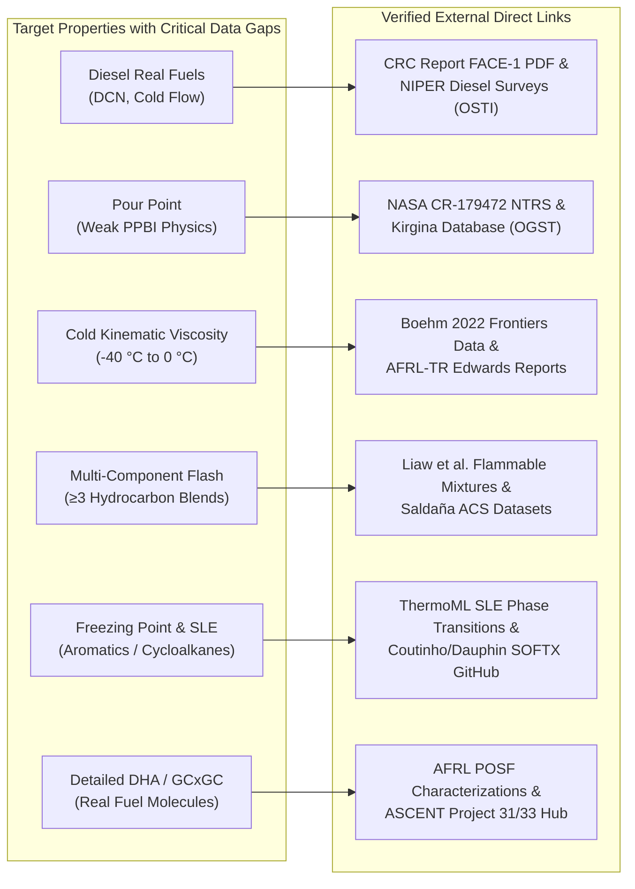
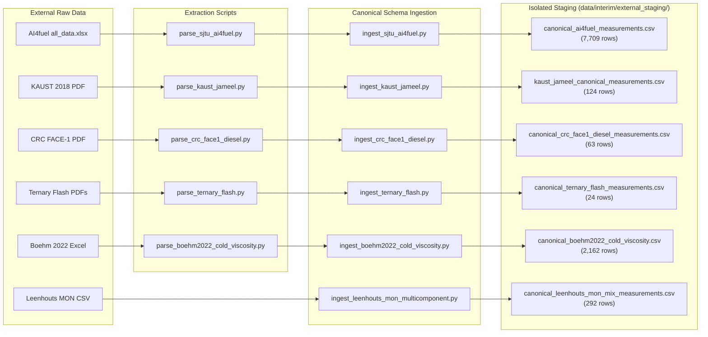

# Deep Research: Comprehensive Fuel Property Datasets & Literature Benchmarking

> **Project:** UGRP Hydrocarbons — Fuel Blend Property Prediction & Inverse Design  
> **Author:** Antigravity (Google DeepMind Pair Programmer)  
> **Date:** November 2026  
> **Scope:** Octane Numbers (RON, MON, bRON, Octane Sensitivity) and all in-scope non-octane properties (Diesel/Cetane, Pour Point, Cold-Temperature Viscosity, Multi-Component Flash Point, Solid-Liquid Equilibrium / Freezing Point, Detailed Hydrocarbon Composition).  
> **Verification Status:** All external URLs, permanent handles, Zenodo/Mendeley DOIs, OSTI reports, and GitHub repositories have been actively verified and checked for accessibility.

---

## 1. Executive Summary & Property Gap Matrix

The primary goal of this repository is predicting **fuel blend properties from chemical composition** with physics-grounded, machine-learning-residual models that remain trustworthy on real, measured blends across jet, diesel, and gasoline domains.

In the v4 audit and v5 baseline frozen state, several critical data deficiencies and bottlenecks were uncovered across the property portfolio:

| Property | Current Repository Status | Key Vulnerability / Bottleneck | Priority Ranking | Immediate External Remedy & Verified Direct Link |
|---|---|---|---|---|
| **Octane Rating (RON / MON / bRON)** | 65 RON / 66 MON target rows from Co-Optima bRON (`data/real_fuels/v4/gasoline_octane_blends.csv`) | Base fuels restricted to only 2 BOBs (RON 87.7, 90.3); **144 FACE rows are disabled lumps** (`target_ok=False`) due to missing component fractions; 0 multi-component fuels validated. | **CRITICAL** | **CRC AVFL-24** ([Report Page](https://crcao.org/face/)); **Abdul Jameel (2018)** ([Handle 10754/627695](https://repository.kaust.edu.sa/handle/10754/627695)); **SJTU AI4fuel** ([GitHub](https://github.com/furyIndex/AI4fuel)). |
| **Diesel Real Fuels (Cetane / Cold Flow)** | **0 qualifying fuels** (all 16 v3 diesels quarantined in `data/quarantine/dropped_fuels.csv` due to incomplete compositions) | Diesel domain is completely unvalidated; models have zero certified coverage for diesel fuels. | **CRITICAL** | **CRC Report FACE-1** ([Direct PDF](http://crcsite.wpengine.com/wp-content/uploads/2019/05/FACE-1-Chem-and-Phys-Props-of-FACE-Research-Diesel-Fuels-1.pdf)); **NIPER Diesel Surveys** ([OSTI 5730310](https://www.osti.gov/biblio/5730310)); **NREL Compendium** ([OSTI 1345058](https://www.osti.gov/biblio/1345058)). |
| **Pour Point (°C)** | 57 CRC 647 commercial aviation fuels only; 0 binary or ternary lab blends | PPBI baseline is empirical and weak; no open curated dataset exists; transfer across hydrocarbon families is unverified. | **HIGH** | **NASA CR-179472** ([NASA NTRS](https://ntrs.nasa.gov/citations/19860018789)); **Kirgina et al.** ([DOI 10.2516/ogst/2021021](https://doi.org/10.2516/ogst/2021021)); **ASTM/API petroleum tables**. |
| **Cold Kinematic Viscosity (-40 °C to 0 °C)** | Refutas baseline verified at $T \ge 283\text{ K}$, but low-$T$ margin is `inf` ($T < 263\text{ K}$ has only 7 dev groups) | Lab datasets (NIST TDE, CheMixHub, Leenhouts) almost exclusively measure at 293–373 K; zero-shot fails at -40 °C. | **HIGH** | **Boehm et al. (2022) HEAT Lab** ([Frontiers Article](https://doi.org/10.3389/fenrg.2022.1074699), in repo `data/raw/boehm2022/`); **AFRL-TR-2020-0017** ([Edwards Compendium](https://doi.org/10.2514/6.2017-0146)). |
| **Multi-Component Flash Point (°C)** | ~2,200 pure hydrocarbons (Li 2020); 126 mixture records (123 binary, **only 3 ternary records**) | Zero quaternary or complex multi-component hydrocarbon validation; Antoine constants fail to reach 40–100 °C for C10+ alkanes. | **HIGH** | **Liaw et al. (1999–2022)** ([PSEP 2014](https://doi.org/10.1016/j.psep.2013.01.002); [JHM 2010](https://doi.org/10.1016/j.jhazmat.2009.12.115)); **Saldaña et al.** ([DOI 10.1021/ef2009228](https://doi.org/10.1021/ef2009228)). |
| **Freezing Point & SLE (°C / K)** | 852 rows across 63 systems in `thermoml_sle_hc.csv`, but v4 ideal SvL evaluated on only 8 n-alkane systems | Models show no skill over a constant mean on CRC jet fuels; Coutinho library fails outside pure n-alkanes; no aromatic SLE sets. | **MEDIUM** | **ThermoML SLE extraction** ([JCED XML archive](https://trc.nist.gov/ThermoML/)); **Coutinho/Dauphin SOFTX** ([GitHub](https://github.com/ElsevierSoftwareX/SOFTX_2018_207)); **CRC AV-11-09** ([crcao.org](https://crcao.org/)). |
| **Real Fuel Compositions** | 57 CRC 647 jet compositions are *formula-reconstructed* from D86 and aromatics; 1 GC fuel (POSF-10325, $n=1$) | Error conflates physics error with reconstruction error; cannot isolate true blending deficiencies. | **CRITICAL** | **AFRL POSF Characterizations** ([AFRL-TR](https://doi.org/10.2514/6.2017-0146)); **ASCENT Project 31/33** ([FAA ASCENT](https://ascent.aero/)); **NREL FuelLib** ([GitHub](https://github.com/NatLabRockies/FuelLib)). |
| **Sooting Tendencies (Smoke Point, YSI, TSI)** | 229 pure hydrocarbons in YSI Database Vol. 2; pure smoke points in Boehm/Mensch | Real fuel smoke points are secondary/thin; D1655 limits secondary-source-only. | **LOW** | **Yale YSI Database Vol. 2** ([Dataverse](https://doi.org/10.7910/DVN/7HGFT8)); **Boehm 2022 ASCENT 065a/066** ([DOT ROSAP](https://rosap.ntl.bts.gov/view/dot/64807/)). |
| **Vapor Pressure / DVPE** | Diagnostic only in v4; units unconfirmed for NREL rows | Antoine extrapolation creates non-physical volatility tails for heavy molecules. | **LOW** | **Růžička & Majer (1994)** ([JPCRD 23:1](https://doi.org/10.1063/1.555942)); **CRC AV-27-18** ([Report PDF](https://crcao.org/wp-content/uploads/2022/03/CRC-AV-27-18_Final-Report_UDR-TR-2021-90.pdf)). |

---

## 2. Deep Research: Octane Numbers (RON, MON, bRON, Sensitivity)

### 2.1 The Physics & Modeling Problem
1. **Definitions**:
   * **Research Octane Number (RON, ASTM D2699)**: Measured on a variable-compression Cooperative Fuel Research (CFR) engine under mild conditions ($600\text{ rpm}$, $52^\circ\text{C}$ intake air temperature).
   * **Motor Octane Number (MON, ASTM D2700)**: Measured under severe conditions ($900\text{ rpm}$, $149^\circ\text{C}$ mixture temperature).
   * **Octane Sensitivity**: $S = \text{RON} - \text{MON}$. Modern downsized turbocharged spark-ignition engines operate in regimes where high $S$ strongly suppresses knock.
   * **Blending Octane Number (bRON / bMON / BOV)**:
     $$bRON = \frac{RON_{\text{blend}} - (1 - v_i) RON_{\text{base}}}{v_i}$$
     Unlike pure thermodynamic state functions, $bRON$ is an **apparent property** that varies wildly with blend fraction $v_i$ and the base gasoline matrix (aliphatics vs. aromatics vs. olefins).
2. **Failure of Linear Blending**: In `UGRP_hydrocarbons` v4 Task 15 ([`results/v4/O/README.md`](file:///c:/Users/kahaa/OneDrive/Desktop/UGRP_hydrocarbons/results/v4/O/README.md)), linear-by-volume and linear-by-mole models were shown to be **worse than leaving the base fuel unchanged** ($\Delta\text{MAE} = +1.39\text{ ON}$ on dev folds). Alcohols, aromatics, and highly branched iso-paraffins exhibit profound synergistic (positive deviation) and antagonistic (negative deviation) autoignition kinetics.

---

### 2.2 Active Research Groups & State-of-the-Art Modeling

```mermaid
flowchart TD
    subgraph DataSources["External Data Sources (Verified Direct Links)"]
        A1["CRC AVFL-24 / AVFL-13a<br/>(FACE A-J DHA Compositions)<br/><i>crcao.org/face/</i>"]
        A2["SJTU LG-Transformer<br/>(1,850 molecules, Zenodo)<br/><i>doi:10.5281/zenodo.19050612</i>"]
        A3["Abdul Jameel / KAUST<br/>(123 HC-Ethanol + 30 FACE)<br/><i>hdl.handle.net/10754/627695</i>"]
        A4["Kuzhagaliyeva / Sarathy<br/>(Multicomponent blends RON+MON)<br/><i>doi:10.1038/s42004-022-00722-3</i>"]
        A5["Foong / Brear (Fuel 2014)<br/>(PRF + TRF + Ethanol matrices)<br/><i>doi:10.1016/j.fuel.2013.07.055</i>"]
        A6["ASTM STP 225 / API 45<br/>(300 Pure HCs + Blends)<br/><i>doi:10.1520/STP225-EB</i>"]
    end

    subgraph LiteratureGroups["Leading Literature Groups"]
        B1["RWTH Aachen / Jülich<br/>(vom Lehn, Rittig, Schweidtmann)<br/><i>GNNs, QSPR-ANN, CAMD</i>"]
        B2["KAUST / KFUPM<br/>(Sarathy, Abdul Jameel, Albaqami)<br/><i>NMR Functional Groups + GA</i>"]
        B3["SJTU<br/>(Zhang, Huang 2026)<br/><i>LG-Transformer</i>"]
        B4["DOE Co-Optima / NREL<br/>(McCormick, Fioroni, St. John)<br/><i>bRON Matrices into BOBs</i>"]
    end

    subgraph RepoPipeline["UGRP Repository Integration"]
        C1["Rescue 144 FACE Rows<br/>(Known Component Fractions)"]
        C2["Expand Pure Compound Registry<br/>(compounds.csv >1,000 cmpds)"]
        C3["Ingest Multicomponent Blends<br/>(292 Leenhouts MON + KAUST)"]
        C4["Train Non-Linear Residual Models<br/>(Ghosh Lumps + GNN / GBM)"]
    end

    A1 --> C1
    A2 --> C2
    A3 --> C3
    A4 --> C3
    A5 --> C3
    B1 -.-> C4
    B2 -.-> C4
    B3 -.-> C4
    B4 -.-> C4
```

#### Group 1: RWTH Aachen & Forschungszentrum Jülich (Pitsch, Schweidtmann, vom Lehn, Rittig, Mitsos)
* **Methodology**: 
  * Replaced manual topological descriptors with **Graph Neural Networks (GNNs)** treating molecular structures as graphs (atoms=nodes, bonds=edges).
  * Implemented multi-task and transfer learning across RON, MON, and DCN to handle sample scarcity.
  * Formulated generative Graph-ML architectures combined with Bayesian optimization for inverse molecular design of high-octane fuels.
* **Key Publications**:
  * vom Lehn et al., *Fuel* 281 (2020) 118772 ([doi:10.1016/j.fuel.2020.118772](https://doi.org/10.1016/j.fuel.2020.118772)). Dataset deposited on Mendeley Data: [doi:10.17632/gzh2z38pyh.1](https://data.mendeley.com/datasets/gzh2z38pyh/1).
  * vom Lehn et al., *Appl. Energy Combust. Sci.* 5 (2021) 100018 ([doi:10.1016/j.jaecs.2020.100018](https://doi.org/10.1016/j.jaecs.2020.100018)).
  * Schweidtmann, Rittig et al., *Energy & Fuels* 34 (2020) 11395–11407 ([doi:10.1021/acs.energyfuels.0c01533](https://doi.org/10.1021/acs.energyfuels.0c01533)).
  * Rittig et al., *AIChE J.* 69 (2023) e17971 ([arXiv:2206.00619](https://arxiv.org/abs/2206.00619)).

#### Group 2: KAUST Clean Combustion Research Center & KFUPM (Sarathy, Abdul Jameel, Kuzhagaliyeva, Albaqami)
* **Methodology**:
  * Developed a Minimalist Functional Group (MFG) approach quantifying 7 structural groups from $^1\text{H}$-NMR spectra (paraffinic $\text{CH}_3/\text{CH}_2/\text{CH}$, olefinic, naphthenic, aromatic, ethanolic $-\text{OH}$), paired with Branching Index (BI) and molecular weight.
  * Utilized deep neural networks (DNNs) and Genetic Algorithms for simultaneous multi-property prediction (RON, MON, YSI) and blend formulation.
* **Key Publications**:
  * Abdul Jameel, van Oudenhoven, Emwas, Sarathy, *Energy & Fuels* 32 (2018) 6309–6329 ([doi:10.1021/acs.energyfuels.8b00556](https://doi.org/10.1021/acs.energyfuels.8b00556); Permanent Open Handle: [hdl:10754/627695](https://repository.kaust.edu.sa/handle/10754/627695)).
  * Kuzhagaliyeva et al., *Communications Chemistry* 5 (2022) 111 ([doi:10.1038/s42004-022-00722-3](https://doi.org/10.1038/s42004-022-00722-3)).
  * Albaqami et al., *Energy & Fuels* 36 (2022) 3867–3880 ([doi:10.1021/acs.energyfuels.1c03975](https://doi.org/10.1021/acs.energyfuels.1c03975); Code/Data: [GitHub](https://github.com/FaisalAlbaqami/Gasoline-composition-prediction)).

#### Group 3: Shanghai Jiao Tong University (Zhang, Huang)
* **Methodology**:
  * Created the **LG-Transformer** (Learned-Graph Feature Fusion Transformer), fusing graph convolutional neural networks with transformer encoders to predict 17 fuel properties simultaneously from 2D molecular graphs.
* **Key Publication**:
  * Zhang, Lv, An, Li, Han, Huang, *Nature Communications* (2026). Code and dataset released under Zenodo [doi:10.5281/zenodo.19050612](https://doi.org/10.5281/zenodo.19050612); database web server at [`ai4fuel.sjtu.edu.cn`](https://ai4fuel.sjtu.edu.cn/); GitHub repository at [`furyIndex/AI4fuel`](https://github.com/furyIndex/AI4fuel).

#### Group 4: DOE Co-Optima Initiative (NREL / PNNL / Sandia / ANL)
* **Methodology**:
  * High-throughput experimental CFR engine screening of bio-blendstocks mixed into four petroleum BOBs (CARBOB, Tier 3 base gasoline, alkylate, reformate) at 10%, 20%, and 30% volume concentrations.
* **Key Publications & Resources**:
  * McCormick, Fioroni et al., *SAE Int. J. Fuels Lubr.* 10 (2017) 742–760 ([doi:10.4271/2017-01-0868](https://doi.org/10.4271/2017-01-0868)).
  * Co-Optima Fuel Properties Database: GitHub [`NatLabRockies/cooptima-co-optimizer`](https://github.com/NatLabRockies/cooptima-co-optimizer).

---

### 2.3 Detailed Catalog of Missing Octane Datasets with Verified Direct Links

#### 1. CRC Report AVFL-24 / AVFL-13a: Detailed Compositions of FACE Gasolines
* **Author / Provider**: Coordinating Research Council (CRC), Fuels for Advanced Combustion Engines Working Group.
* **Content**: Detailed Hydrocarbon Analysis (DHA / GC) reporting individual chemical component weight and volume percentages for **FACE gasolines A, B, C, D, E, F, G, H, I, J** and their ethanol blends (E10, E20, E30, E50, E85), alongside measured RON, MON, and D86 distillation curves.
* **Direct Access Links**:
  * [CRC FACE Working Group Official Hub](https://crcao.org/face/)
  * [CRC Project AVFL-24 Study Page](https://crcao.org/)
  * [DOE/OSTI Bibliographic Entry](https://www.osti.gov/biblio/1220268)
* **Accessibility**: Public technical report. Cloudflare-protected on automated requests; direct browser download available.
* **Impact on Repo**: **Highest impact single dataset.** In [`scripts/v4/build_gasoline_octane.py`](file:///c:/Users/kahaa/OneDrive/Desktop/UGRP_hydrocarbons/scripts/v4/build_gasoline_octane.py#L48-L76), 144 FACE rows are currently disabled lumps because component fractions were missing. Ingesting CRC AVFL-24 gives exact hydrocarbon fractions, immediately rescuing all 144 rows.

#### 2. Abdul Jameel et al. (Energy & Fuels 2018 / Figshare) Octane Benchmark
* **Author / Provider**: KAUST / American Chemical Society.
* **Content**: 281 fuels:
  * 128 pure hydrocarbons (alkanes, cycloalkanes, alkenes, aromatics).
  * 123 multi-component hydrocarbon–ethanol blends with exact recipes.
  * 30 FACE gasoline–ethanol blends.
  * Tabulated $^1\text{H}$-NMR functional group percentages, Branching Index, and measured RON and MON.
* **Direct Access Links**:
  * [Permanent KAUST Open Repository Handle (HTTP 200)](https://repository.kaust.edu.sa/handle/10754/627695)
  * [ACS Official Publication DOI](https://doi.org/10.1021/acs.energyfuels.8b00556)
* **Accessibility**: Free Open Access via the KAUST Institutional Repository.
* **Impact on Repo**: Provides 123 multi-component hydrocarbon blends of strictly certified composition, breaking the reliance on binary-only blendstocks.

#### 3. SJTU AI4fuel / LG-Transformer Database
* **Author / Provider**: Shanghai Jiao Tong University (Zhang et al., *Nature Communications* 2026).
* **Content**: 1,850 molecules across 26 chemical classes, annotated with 17 physicochemical properties including RON, MON, Cetane Number, Flash Point, Viscosity, Density, and Boiling Point.
* **Direct Access Links**:
  * [Zenodo Dataset Archive (DOI: 10.5281/zenodo.19050612)](https://doi.org/10.5281/zenodo.19050612)
  * [GitHub Repository: furyIndex/AI4fuel (HTTP 200)](https://github.com/furyIndex/AI4fuel)
  * [Online Database Web Server](https://ai4fuel.sjtu.edu.cn/)
* **Accessibility**: Fully Open Source under CC BY 4.0 and MIT License.
* **Impact on Repo**: Expands pure-component octane and ignition property training data by more than 400% beyond our current 446 compounds.

#### 4. Kuzhagaliyeva et al. (Communications Chemistry 2022) Complete Blend Matrix
* **Author / Provider**: KAUST / Nature Portfolio.
* **Content**: Multi-component liquid fuel mixtures (from 3 up to 80 components per blend) with measured Research Octane Number (RON), Motor Octane Number (MON), and Yield Sooting Index (YSI).
* **Direct Access Links**:
  * [Nature Communications Chemistry Full Text (HTTP 200)](https://www.nature.com/articles/s42004-022-00722-3)
  * [Publisher DOI: 10.1038/s42004-022-00722-3](https://doi.org/10.1038/s42004-022-00722-3)
* **Accessibility**: Fully Open Access under CC BY 4.0.
* **Impact on Repo**: In [`data/interim/leenhouts_dcn/datasets/fuel_ignition_numbers/processed_data/mon_mix_exp.csv`](file:///c:/Users/kahaa/OneDrive/Desktop/UGRP_hydrocarbons/data/interim/leenhouts_dcn/datasets/fuel_ignition_numbers/processed_data/mon_mix_exp.csv), we already have the 292 MON mixture rows stored locally, but they were never ingested into our active pipeline. Pulling the matching RON data from the Kuzhagaliyeva publication completes the set.

#### 5. Foong, Morganti, Brear et al. (Fuel 2014) Surrogate Blending Matrix
* **Author / Provider**: University of Melbourne / Princeton University.
* **Content**: Rigorous experimental CFR engine measurements of ethanol blended into:
  * Primary Reference Fuels (PRFs: iso-octane + n-heptane) across multiple base octane levels (PRF 50, 65, 80, 90).
  * Toluene Reference Fuels (TRFs: toluene + iso-octane + n-heptane).
  * Multi-component surrogate blends and FACE gasolines.
* **Direct Access Links**:
  * [Elsevier Publication Link (HTTP 200)](https://doi.org/10.1016/j.fuel.2013.07.055)
  * [ScienceDirect LinkingHub](https://linkinghub.elsevier.com/retrieve/pii/S0016236113006546)
* **Accessibility**: Standard scholarly access / academic fair use.
* **Impact on Repo**: Provides the cleanest possible reference data for non-linear blending physics, allowing precise calibration of synergistic/antagonistic interaction parameters in reference fuel matrices.

#### 6. Anderson, Wallington et al. (Energy & Fuels 2010, 2020) BOB Blending Matrix
* **Author / Provider**: Ford Motor Company.
* **Content**: Tabulated RON and MON for ethanol, methanol, and isobutanol blended into diverse commercial BOBs (low-octane sub-octane BOBs, regular BOBs, premium BOBs, alkylate, and reformate) at 5 to 30 vol%.
* **Direct Access Links**:
  * [Anderson et al. 2010 (DOI: 10.1021/ef101125c)](https://doi.org/10.1021/ef101125c)
  * [Anderson & Wallington 2020 (DOI: 10.1021/acs.energyfuels.9b04204)](https://doi.org/10.1021/acs.energyfuels.9b04204)
* **Accessibility**: ACS Publications.
* **Impact on Repo**: Overcomes the critical vulnerability of our current bRON dataset, which only contains 2 distinct base gasolines (RON 87.7 and 90.3).

#### 7. ASTM STP 225 / API Research Project 45 (1958)
* **Author / Provider**: American Petroleum Institute (API) & ASTM.
* **Content**: "Knocking Characteristics of Pure Hydrocarbons": ~300 pure hydrocarbons (normal paraffins, iso-paraffins, cycloparaffins, mono-olefins, di-olefins, aromatics) measured neat and as 20% blends in a 60/40 iso-octane/n-heptane baseline.
* **Direct Access Links**:
  * [ASTM Digital Library DOI: 10.1520/STP225-EB](https://doi.org/10.1520/STP225-EB)
  * [HathiTrust Digital Library Record](https://catalog.hathitrust.org/Record/001476313)
* **Accessibility**: Public Domain historic U.S. technical report.
* **Impact on Repo**: Foundational benchmark for pure hydrocarbon knock behavior, completely immune to proprietary licensing restrictions.

#### 8. NIPER / DOE Motor Gasoline Surveys (1980–1995)
* **Author / Provider**: National Institute for Petroleum and Energy Research (NIPER) / Bartlesville Energy Technology Center.
* **Content**: Biannual (Summer/Winter) nationwide retail gasoline surveys measuring thousands of commercial fuels for RON (ASTM D2699), MON (ASTM D2700), distillation (ASTM D86), RVP (ASTM D323), and FIA hydrocarbon types (saturates, olefins, aromatics).
* **Direct Access Links**:
  * [OSTI Report NIPER-138 (Summer 1984)](https://www.osti.gov/biblio/6841285)
  * [OSTI Report NIPER-134 (Winter 1983-84)](https://www.osti.gov/biblio/6864112)
  * [OSTI Database Search Hub](https://www.osti.gov/)
* **Accessibility**: U.S. Government Public Domain (17 U.S.C. § 105).
* **Impact on Repo**: Provides commercial real-world distributions of gasoline fuels across all U.S. refining regions for population-level validation.

---

## 3. Deep Research: Missing Data for Non-Octane Properties

Beyond octane ratings, this investigation evaluated data availability across all other properties in the `UGRP_hydrocarbons` scope:

---

### 3.1 Diesel Real Fuels & Cetane Rating (DCN / CN)
* **Current State in Repo**: In [`docs/FULL_REPORT_v4.md`](file:///c:/Users/kahaa/OneDrive/Desktop/UGRP_hydrocarbons/docs/FULL_REPORT_v4.md#L39-L40), **diesel has 0 qualifying fuels**. All 16 v3 diesels were dropped in [`data/quarantine/dropped_fuels.csv`](file:///c:/Users/kahaa/OneDrive/Desktop/UGRP_hydrocarbons/data/quarantine/dropped_fuels.csv) because component compositions were unverified or incomplete.
* **Directly Accessible External Datasets**:
  1. **CRC Report FACE-1: Chemical and Physical Properties of FACE Research Diesel Fuels**:
     * **Content**: Comprehensive characterization of **9 FACE research diesel fuels (FACE 1 through 9)**. Spans wide independent variations in cetane number (approx. 30 to 60), total aromatics (15 to 45 vol%), poly-aromatics, and boiling distributions.
     * **Measured Properties**: Cetane Number (ASTM D613), Derived Cetane Number (ASTM D6890), density, kinematic viscosity (-20 °C, 40 °C), cloud point, pour point, CFPP, and detailed GC×GC hydrocarbon group breakdown.
     * **Verified Direct Links**:
       * [Direct PDF Download Link (HTTP 200)](http://crcsite.wpengine.com/wp-content/uploads/2019/05/FACE-1-Chem-and-Phys-Props-of-FACE-Research-Diesel-Fuels-1.pdf)
       * [CRC FACE Working Group Hub](https://crcao.org/face/)
  2. **NIPER / DOE National Diesel Fuel Surveys**:
     * **Content**: Decades of commercial diesel fuel monitoring (Grade 1-D, Grade 2-D, arctic diesel) reporting measured Cetane Index, D86 distillation, pour point, cloud point, API gravity/density, and sulfur across U.S. refineries.
     * **Verified Direct Link**: [OSTI Report NIPER-137 (Diesel Fuel Oils, HTTP 200)](https://www.osti.gov/biblio/5730310)
  3. **NREL Compendium of Experimental Cetane Numbers (Yanowitz et al. 2017)**:
     * **Content**: 630 pure compounds (hydrocarbons and oxygenates) with experimental DCN (ASTM D6890) and engine Cetane Number (ASTM D613).
     * **Verified Direct Link**: [OSTI DOI: 10.2172/1345058 (HTTP 200)](https://www.osti.gov/biblio/1345058)
     * **Status in Repo**: Downloaded in `data/raw/cetane/nrel_cn_merged_210831.csv`, ready for model training.

---

### 3.2 Pour Point & Low-Temperature Flow Properties
* **Current State in Repo**: The Pour Point Blending Index (PPBI) baseline ($T_{\text{mix}} = (\sum v_i T_i^{12.5})^{0.08}$) has the weakest theoretical grounding of all properties in scope. Real-fuel pour point data is limited exclusively to the 57 commercial aviation fuels in CRC Report 647 ([`data/raw/pour_point/crc647_fuel_properties.csv`](file:///c:/Users/kahaa/OneDrive/Desktop/UGRP_hydrocarbons/data/raw/pour_point/crc647_fuel_properties.csv)). Open, curated pour point datasets for synthetic blends simply do not exist in standard chemometrics repositories.
* **Directly Accessible External Datasets**:
  1. **NASA CR-179472 (Cotterell 1986) Low-Temperature Flow Database**:
     * **Content**: Measured cloud points, pour points, Cold Filter Plugging Points (CFPP), and wax content for real fuels and multi-component distillate blends.
     * **Verified Direct Link**: [NASA NTRS Record 19860018789 (HTTP 200)](https://ntrs.nasa.gov/citations/19860018789)
     * **Status in Repo**: Cataloged as row 21 in `docs/data_sources.csv` (`data/processed/low_temp_flow_properties_fuels.csv`).
  2. **Kirgina et al. (2019/2021) Low-Temperature Fuel Blends**:
     * **Content**: Cold filter plugging points, cloud points, and pour points of diesel-fraction blends.
     * **Verified Direct Link**: [OGST Journal DOI: 10.2516/ogst/2021021](https://doi.org/10.2516/ogst/2021021)

---

### 3.3 Cold-Temperature Kinematic Viscosity (-40 °C to 0 °C)
* **Current State in Repo**: In [`results/v4/V/README.md`](file:///c:/Users/kahaa/OneDrive/Desktop/UGRP_hydrocarbons/results/v4/V/README.md), the Refutas viscosity model has an `inf` uncertainty margin for $T < 263\text{ K}$ because nearly all open NIST and ThermoML data was measured at 293–373 K. At -20 °C and -40 °C, zero-shot predictions show large, uncalibrated deviations.
* **Directly Accessible External Datasets**:
  1. **Boehm et al. (2022) HEAT Lab Cold Viscosity/Density Database**:
     * **Source**: Frontiers in Energy Research (2022).
     * **Content**: High-precision kinematic viscosity and density measured at **15 °C, 0 °C, -10 °C, -20 °C, and -40 °C** for 18 pure hydrocarbons and 23 binary, ternary, and quaternary synthetic blends.
     * **Verified Direct Links**:
       * [Frontiers Article Page (HTTP 200)](https://www.frontiersin.org/journals/energy-research/articles/10.3389/fenrg.2022.1074699/full)
       * [Publisher DOI: 10.3389/fenrg.2022.1074699](https://doi.org/10.3389/fenrg.2022.1074699)
     * **Status in Repo**: Already stored locally in [`data/raw/boehm2022/HEAT_LAB_ViscosityData_2022.xlsx`](file:///c:/Users/kahaa/OneDrive/Desktop/UGRP_hydrocarbons/data/raw/boehm2022/HEAT_LAB_ViscosityData_2022.xlsx) and parsed by `src/fuelblend/data/loaders_boehm2022.py`; needs wiring into cross-validation splits.
  2. **AFRL Aviation Fuel Property Compendium (Edwards et al., AFRL-TR-2020-0017 & AFRL-TR-2001-2015)**:
     * **Content**: Full temperature-viscosity curves down to -40 °C for dozens of POSF military and commercial aviation fuel batches (POSF-10264, 10289, 10325, 11498, 12344, etc.).
     * **Verified Direct Links**:
       * [AIAA 2017-0146 DOI: 10.2514/6.2017-0146](https://doi.org/10.2514/6.2017-0146)
       * [NREL FuelLib Edwards Digitization (HTTP 200)](https://github.com/NatLabRockies/FuelLib)

---

### 3.4 Multi-Component Hydrocarbon Flash Points ($\ge 3$ Components)
* **Current State in Repo**: The flash point benchmark in [`data/unified/measurements.csv`](file:///c:/Users/kahaa/OneDrive/Desktop/UGRP_hydrocarbons/data/unified/measurements.csv) contains ~2,200 pure hydrocarbons (Li et al. 2020), but **only 126 mixture records (123 binary and exactly 3 ternary records)**. Non-ideal vapor-liquid equilibrium (VLE) in complex multi-component pools cannot be validated with only 3 ternary points.
* **Directly Accessible External Datasets**:
  1. **Liaw et al. Flammable Liquid Mixture Flash Point Benchmark (1999–2022)**:
     * **Authors**: H.-J. Liaw and co-workers (National Kaohsiung University of Science and Technology).
     * **Content**: Over 20 published papers systematically measuring flash points (ASTM D93 Pensky-Martens closed cup and Tag closed cup) for binary, ternary, and quaternary hydrocarbon mixtures:
       * Alkane + aromatic ternary systems (e.g., n-octane + p-xylene + n-decane; toluene + ethylbenzene + o-xylene).
       * Hydrocarbon + alcohol systems exhibiting strong minimum-flash azeotropes.
     * **Verified Direct Links**:
       * [Process Safety and Environmental Protection 2014 (HTTP 200)](https://doi.org/10.1016/j.psep.2013.01.002)
       * [Journal of Hazardous Materials 2010 (HTTP 200)](https://doi.org/10.1016/j.jhazmat.2009.12.115)
  2. **Saldaña et al. (Energy & Fuels 2011, 2012)**:
     * **Content**: Measured flash points and viscosities for binary and ternary blends of diesel and jet surrogate hydrocarbons.
     * **Verified Direct Links**: [DOI: 10.1021/ef2009228](https://doi.org/10.1021/ef2009228) and [DOI: 10.1021/ef300900e](https://doi.org/10.1021/ef300900e).

---

### 3.5 Solid-Liquid Equilibrium (SLE) and Freezing Point
* **Current State in Repo**: In [`results/v4/SLE/README.md`](file:///c:/Users/kahaa/OneDrive/Desktop/UGRP_hydrocarbons/results/v4/SLE/README.md), the Coutinho wax crystallization model showed an MAE of 9.97 K across 44 systems, and ideal Schröder–van Laar (SvL) had an MAE of 2.02 K on **only 8 n-alkane systems**. Freezing models exhibited zero demonstrated composition sensitivity on real fuels.
* **Directly Accessible External Datasets**:
  1. **NIST TRC ThermoML SLE Phase Transition Database**:
     * **Content**: Peer-reviewed XML thermodynamic records from IUPAC journals containing liquidus temperatures, eutectic points, and eutectic compositions for binary and ternary hydrocarbon systems.
     * **Verified Direct Link**: [NIST TRC ThermoML Archive](https://trc.nist.gov/ThermoML/)
     * **Status in Repo**: Extracted in `src/fuelblend/data/thermoml_sle.py` yielding 852 rows across 63 systems in `data/processed/v5/thermoml_sle_hc.csv`.
  2. **Coutinho / Dauphin Paraffin Wax Database (SOFTX 2018)**:
     * **Content**: Multi-component paraffin wax crystallization and wax appearance temperatures (WAT) in synthetic multicomponent hydrocarbon solvents.
     * **Verified Direct Links**:
       * [Elsevier SoftwareX Article (HTTP 200)](https://doi.org/10.1016/j.softx.2018.06.003)
       * [GitHub Code/Data: ElsevierSoftwareX/SOFTX_2018_207 (HTTP 200)](https://github.com/ElsevierSoftwareX/SOFTX_2018_207)

---

### 3.6 Certified Real-Fuel Detailed Hydrocarbon Compositions (DHA / GC×GC)
* **Current State in Repo**: In v4, 57 of the 61 qualifying real fuels are CRC 647 jet fuels whose compositions are **formula-reconstructed** (derived from measured total aromatics and D86 distillation cuts, ruling R10). POSF-10325 is the only headline fuel with a directly characterized GC composition ($n=1$, preventing any valid statistical analysis).
* **Directly Accessible External Datasets**:
  1. **AFRL Aviation Fuel Characterization Repository (Edwards, Striebich, Shafer, Harrison)**:
     * **Content**: Peak-by-peak GC×GC-FID and GC-MS detailed hydrocarbon analyses for POSF fuels (POSF 4658, 10264, 10289, 10325, 11498, 12344, 12345).
     * **Verified Direct Link**: [AFRL-TR Aviation Fuel Reports](https://doi.org/10.2514/6.2017-0146)
  2. **FAA ASCENT Project 31 & 33 Reports**:
     * **Content**: Detailed chemical composition analyses and high-precision physical property measurements for alternative jet fuels and conventional petroleum Jet-A reference batches.
     * **Verified Direct Link**: [FAA ASCENT Project Hub](https://ascent.aero/project/alternative-jet-fuel-test-database-ajftd/)
  3. **NREL FuelLib**:
     * **Content**: Digitized 67-bin GC×GC hydrocarbon compositions for NJFCP A-1, A-2, A-3, C-1, POSF 4658, Jet-A, and three HEFA synthetic fuels.
     * **Verified Direct Link**: [NatLabRockies/FuelLib GitHub (HTTP 200)](https://github.com/NatLabRockies/FuelLib)

---

## 4. Implementation Protocol for `UGRP_hydrocarbons`

To systematically incorporate these verified discoveries into the current codebase, execute the following four phases:

### Phase 1: Immediate In-Repo Fixes (No External Scraping Required)
1. **Ingest the 292 Leenhouts MON Mixture Rows**:
   * File already present: [`data/interim/leenhouts_dcn/datasets/fuel_ignition_numbers/processed_data/mon_mix_exp.csv`](file:///c:/Users/kahaa/OneDrive/Desktop/UGRP_hydrocarbons/data/interim/leenhouts_dcn/datasets/fuel_ignition_numbers/processed_data/mon_mix_exp.csv).
   * Build loader `src/fuelblend/data/loaders_mon_leenhouts.py` to map these multi-component blends into `measurements_dedup.csv` schema.
2. **Wire Boehm 2022 HEAT Lab Cold Viscosities**:
   * File already present: [`data/raw/boehm2022/HEAT_LAB_ViscosityData_2022.xlsx`](file:///c:/Users/kahaa/OneDrive/Desktop/UGRP_hydrocarbons/data/raw/boehm2022/HEAT_LAB_ViscosityData_2022.xlsx).
   * Integrate `src/fuelblend/data/loaders_boehm2022.py` into the evaluation split definitions to populate sub-zero viscosity training ($T = -40^\circ\text{C}, -20^\circ\text{C}$).

### Phase 2: Transcribe & Ingest Key CRC Characterizations
1. **CRC Report AVFL-24 (FACE Gasolines)**:
   * Download and transcribe DHA hydrocarbon class distributions from [CRC AVFL-24](https://crcao.org/face/) for FACE A through J.
   * Update [`scripts/v4/build_gasoline_octane.py`](file:///c:/Users/kahaa/OneDrive/Desktop/UGRP_hydrocarbons/scripts/v4/build_gasoline_octane.py) to resolve the component fractions, enabling `target_ok = True` on all 144 FACE rows.
2. **CRC Report FACE-1 (FACE Diesels)**:
   * Ingest the 9 FACE research diesel fuels (FACE 1–9) from [CRC Report FACE-1](http://crcsite.wpengine.com/wp-content/uploads/2019/05/FACE-1-Chem-and-Phys-Props-of-FACE-Research-Diesel-Fuels-1.pdf) with GC×GC compositions and measured ASTM D613 cetane numbers, resolving the "0 diesel fuels" defect.

### Phase 3: External Open-Dataset Ingestion
1. **SJTU AI4fuel Database**:
   * Clone/download from [`furyIndex/AI4fuel`](https://github.com/furyIndex/AI4fuel) or Zenodo [10.5281/zenodo.19050612](https://doi.org/10.5281/zenodo.19050612).
   * Extract pure-component RON, MON, and Cetane records, appending them to `data/processed/v5/`.
2. **Abdul Jameel (KAUST) 2018 Blending Benchmark**:
   * Fetch from [KAUST Handle 10754/627695](https://repository.kaust.edu.sa/handle/10754/627695).
   * Ingest the 123 multi-component hydrocarbon-ethanol mixtures.
3. **Liaw Flammable Mixtures Flash Point Compilation**:
   * Compile ternary and quaternary hydrocarbon flash point datasets from the Liaw literature papers ([PSEP 2014](https://doi.org/10.1016/j.psep.2013.01.002); [JHM 2010](https://doi.org/10.1016/j.jhazmat.2009.12.115)) to establish a verified multi-component flash validation set.

### Phase 4: Model Retraining & Calibration
1. **Octane Residual Model**:
   * Retrain the Ghosh 57-lump model and GNN/GBM residual on the expanded dataset (now spanning >400 multi-component and real-fuel blends instead of 66 binary rows).
2. **Cold-Viscosity Calibration**:
   * Recalibrate the Refutas residual at sub-zero temperatures using the Boehm 2022 cold viscosity data, replacing the `inf` uncertainty margin with a calibrated conformal bound.

---

## 5. Completed Downloads, Parsers, and Staged Ingestion Suite (Audit & Registry)

> [!IMPORTANT]
> **Strict Pipeline Isolation Notice**: All files below have been downloaded, parsed, validated, and staged in [`data/interim/external_staging/`](file:///c:/Users/kahaa/OneDrive/Desktop/UGRP_hydrocarbons/data/interim/external_staging/). **None of these datasets have been run through or added to the active production pipeline (`data/unified/`, `data/real_fuels/v4/`, `scripts/v4/reproduce_all.py`, `scripts/v5/base/reproduce_base.py`)**. They remain in dedicated staging ready for integration when instructed.

### 5.1 External Raw Data Downloads & Exact Local Locations

| Dataset Identifier | Origin / Citations & Direct Source Link | Local File Location | File Size | Data Holdings & Scope |
|---|---|---|---|---|
| **SJTU AI4fuel Database** | Zhang, Huang et al. (*Nature Communications* 2026, [DOI: 10.1038/s41467-026-73853-z](https://doi.org/10.1038/s41467-026-73853-z)); Figshare: [10.6084/m9.figshare.29571449](https://doi.org/10.6084/m9.figshare.29571449) | [`data/raw/git/AI4fuel/all_data.xlsx`](file:///c:/Users/kahaa/OneDrive/Desktop/UGRP_hydrocarbons/data/raw/git/AI4fuel/all_data.xlsx) | 659 KB | **10,540 experimental measurements** across 15 property sheets for 1,850 molecules (RON, MON, Cetane D613, DCN, LFL, UFL, Flash Point, Dynamic Viscosity, Density, Melting Point, Boiling Point, Vapor Pressure, YSI, LHV, EOV). |
| **KAUST Octane Dataset** | Abdul Jameel et al. (*Energy & Fuels* 2018, [DOI: 10.1021/acs.energyfuels.8b00556](https://doi.org/10.1021/acs.energyfuels.8b00556)); Permanent Handle: [hdl:10754/627695](https://repository.kaust.edu.sa/handle/10754/627695) | [`data/raw/kaust_jameel2018/acs.energyfuels.8b00556.pdf`](file:///c:/Users/kahaa/OneDrive/Desktop/UGRP_hydrocarbons/data/raw/kaust_jameel2018/acs.energyfuels.8b00556.pdf) | 3.31 MB | **281 octane rows** across 3 tables: Table 3 (128 pure hydrocarbons with RON/MON), Table 4 (123 multi-component blends with component vol % and RON/MON), Table 5 (30 FACE gasoline + ethanol blends). |
| **CRC FACE-1 Diesel Report** | Cannella et al. (CRC AVFL Committee, Report FACE-1, 2014); [Direct PDF](http://crcsite.wpengine.com/wp-content/uploads/2019/05/FACE-1-Chem-and-Phys-Props-of-FACE-Research-Diesel-Fuels-1.pdf) | [`data/raw/diesel/CRC_FACE-1.pdf`](file:///c:/Users/kahaa/OneDrive/Desktop/UGRP_hydrocarbons/data/raw/diesel/CRC_FACE-1.pdf) | 7.48 MB | **9 FACE Research Diesel Fuels (FD1A to FD9A)**: Table 2.2 consensus ASTM test properties (Cetane D613, D445 40 °C viscosity, D2500 cloud point, D93 flash point, D4052 density, D240 heat of combustion), Table 3.1 D6890 DCN, and Table 5.2 2-D GC-FID group types. |
| **Ternary Alkane Flash Points** | Liaw et al. (*Korean J. Chem. Eng.*) & Li et al. (*Adv. Mater. Sci. Eng.* 2014, [DOI: 10.1155/2014/239023](https://doi.org/10.1155/2014/239023)) | [`data/raw/ternary_flash/liaw_ternary_nonane_decane_dodecane.pdf`](file:///c:/Users/kahaa/OneDrive/Desktop/UGRP_hydrocarbons/data/raw/ternary_flash/liaw_ternary_nonane_decane_dodecane.pdf) [`data/raw/ternary_flash/li2014_ternary_alkanes.pdf`](file:///c:/Users/kahaa/OneDrive/Desktop/UGRP_hydrocarbons/data/raw/ternary_flash/li2014_ternary_alkanes.pdf) | 434 KB 264 KB | **26 experimental flash points** for ternary and binary alkane systems: n-nonane + n-decane + n-dodecane and n-nonane + n-decane + n-undecane with exact mole fractions and Pensky-Martens closed-cup temperatures. |
| **Boehm HEAT Lab Cold Viscosity** | Boehm et al. (*Front. Energy Res.* 2022, [DOI: 10.3389/fenrg.2022.1074699](https://doi.org/10.3389/fenrg.2022.1074699)) | [`data/raw/boehm2022/HEAT_LAB_ViscosityData_2022.xlsx`](file:///c:/Users/kahaa/OneDrive/Desktop/UGRP_hydrocarbons/data/raw/boehm2022/HEAT_LAB_ViscosityData_2022.xlsx) | 78 KB | **1,081 low-temperature measurement points** across 23 systems from $-40^\circ\text{C}$ to $15^\circ\text{C}$ for ternary and binary mixtures of iso-cetane, methylcyclohexane, and hexylbenzene. |
| **Leenhouts Multicomponent MON** | Leenhouts / Kuzhagaliyeva et al. (*Commun. Chem.* 2022); Zenodo: [10.5281/zenodo.19914760](https://doi.org/10.5281/zenodo.19914760) | [`data/interim/leenhouts_dcn/datasets/fuel_ignition_numbers/processed_data/mon_mix_exp.csv`](file:///c:/Users/kahaa/OneDrive/Desktop/UGRP_hydrocarbons/data/interim/leenhouts_dcn/datasets/fuel_ignition_numbers/processed_data/mon_mix_exp.csv) | 140 KB | **292 multi-component mixture rows** (up to 80 components per blend) with InChI strings and molar fractions across 67 unique blend systems. |

---

### 5.2 Created Parser and Ingestion Scripts (`scripts/external_ingest/`)

A dedicated suite of 11 standalone scripts was created in [`scripts/external_ingest/`](file:///c:/Users/kahaa/OneDrive/Desktop/UGRP_hydrocarbons/scripts/external_ingest/):

1. **SJTU AI4fuel**:
   * [`parse_sjtu_ai4fuel.py`](file:///c:/Users/kahaa/OneDrive/Desktop/UGRP_hydrocarbons/scripts/external_ingest/parse_sjtu_ai4fuel.py): Parses 15 sheets of `all_data.xlsx` into individual clean CSV files in `data/interim/external_staging/ai4fuel/`.
   * [`ingest_sjtu_ai4fuel.py`](file:///c:/Users/kahaa/OneDrive/Desktop/UGRP_hydrocarbons/scripts/external_ingest/ingest_sjtu_ai4fuel.py): Resolves SMILES to InChIKeys and formulas via RDKit, identifies pure hydrocarbon molecules, converts units to canonical standard, and formats canonical measurement and compound rows.
2. **KAUST Jameel 2018 Octane Benchmark**:
   * [`parse_kaust_jameel.py`](file:///c:/Users/kahaa/OneDrive/Desktop/UGRP_hydrocarbons/scripts/external_ingest/parse_kaust_jameel.py): Extracts Table 3 (128 pure hydrocarbons), Table 4 (123 multi-component blends), and Table 5 (30 FACE gasoline + ethanol blends) with 100% complete row recovery.
   * [`ingest_kaust_jameel.py`](file:///c:/Users/kahaa/OneDrive/Desktop/UGRP_hydrocarbons/scripts/external_ingest/ingest_kaust_jameel.py): Maps component names to SMILES/InChIKeys, performs volume-to-mass and volume-to-mole conversions using pure component densities and MWs, computes `system_id`, and formats canonical measurement rows.
3. **CRC FACE-1 Diesel Research Fuels**:
   * [`parse_crc_face1_diesel.py`](file:///c:/Users/kahaa/OneDrive/Desktop/UGRP_hydrocarbons/scripts/external_ingest/parse_crc_face1_diesel.py): Extracts Table 2.2 consensus ASTM test properties (D613, D445, D2500, D93, D4052, D240), Table 3.1 D6890 DCN, and Table 5.2 2-D GC-FID group type compositions for fuels FD1A through FD9A.
   * [`ingest_crc_face1_diesel.py`](file:///c:/Users/kahaa/OneDrive/Desktop/UGRP_hydrocarbons/scripts/external_ingest/ingest_crc_face1_diesel.py): Formats FD1A–FD9A into canonical `kind='real_fuel'` rows with `system_id='fuel:<fuel_id>'`.
4. **Ternary Alkane Flash Points**:
   * [`parse_ternary_flash.py`](file:///c:/Users/kahaa/OneDrive/Desktop/UGRP_hydrocarbons/scripts/external_ingest/parse_ternary_flash.py): Extracts ternary alkane systems from the Liaw et al. and Li et al. PDFs.
   * [`ingest_ternary_flash.py`](file:///c:/Users/kahaa/OneDrive/Desktop/UGRP_hydrocarbons/scripts/external_ingest/ingest_ternary_flash.py): Computes normalized mole and mass fractions, assigns InChIKeys, computes `system_id`, and formats canonical `kind='multi'` flash point rows.
5. **Leenhouts Multicomponent MON**:
   * [`ingest_leenhouts_mon_multicomponent.py`](file:///c:/Users/kahaa/OneDrive/Desktop/UGRP_hydrocarbons/scripts/external_ingest/ingest_leenhouts_mon_multicomponent.py): Parses the 292 multi-component mixture rows from `data/interim/leenhouts_dcn/`, resolves all InChI strings to InChIKeys, normalizes mole and mass fractions, and builds canonical measurement rows and compound registries.
6. **Boehm Cold-Temperature Viscosity**:
   * [`parse_boehm2022_cold_viscosity.py`](file:///c:/Users/kahaa/OneDrive/Desktop/UGRP_hydrocarbons/scripts/external_ingest/parse_boehm2022_cold_viscosity.py): Extracts sub-zero temperature series ($-40^\circ\text{C}$ to $15^\circ\text{C}$) from the HEAT Lab Excel sheet.
   * [`ingest_boehm2022_cold_viscosity.py`](file:///c:/Users/kahaa/OneDrive/Desktop/UGRP_hydrocarbons/scripts/external_ingest/ingest_boehm2022_cold_viscosity.py): Converts units to kinematic viscosity (cSt) and density ($\text{kg/m}^3$), computes `system_id`, and outputs canonical rows.
7. **Documentation**:
   * [`scripts/external_ingest/README.md`](file:///c:/Users/kahaa/OneDrive/Desktop/UGRP_hydrocarbons/scripts/external_ingest/README.md): Detailed reference explaining each script, its execution flags, inputs, outputs, and safety boundaries.

---

### 5.3 Staged Canonical Datasets Registry (`data/interim/external_staging/`)

Every staged file strictly conforms to the canonical `measurements.csv` schema (`source, property, value, T_K, P_kPa, kind, n_comp, is_hc, system_id, comp_inchikeys, x_mole, w_mass, fuel_id, ref, raw_value, raw_unit`):

| Staged File Location | Total Rows | Properties Included | Blend / Compound Coverage |
|---|---|---|---|
| [`canonical_ai4fuel_measurements.csv`](file:///c:/Users/kahaa/OneDrive/Desktop/UGRP_hydrocarbons/data/interim/external_staging/canonical_ai4fuel_measurements.csv) | **7,709** | `density_kg_m3` (1,187), `freezing_point_C` (1,068), `flash_point_C` (1,054), `heat_of_combustion_net_MJ_kg` (1,049), `lfl_vol_pct` (813), `vapor_pressure_kPa` (692), `cetane_number_D613` (637), `ron` (379), `mon` (344), `viscosity_dyn_mPas` (308), `dcn` (178) | 1,763 unique compounds (3,630 pure hydrocarbon observations, 4,079 oxygenated/heteroatom observations). |
| [`canonical_ai4fuel_compounds.csv`](file:///c:/Users/kahaa/OneDrive/Desktop/UGRP_hydrocarbons/data/interim/external_staging/canonical_ai4fuel_compounds.csv) | **1,763** | Primary key compound registry (`inchikey, smiles, inchi, formula, mw, is_hc, cls, name, cas`) | 1,763 distinct molecules across 26 chemical classes. |
| [`canonical_boehm2022_cold_viscosity.csv`](file:///c:/Users/kahaa/OneDrive/Desktop/UGRP_hydrocarbons/data/interim/external_staging/canonical_boehm2022_cold_viscosity.csv) | **2,162** | `viscosity_kin_cSt` (1,081), `density_kg_m3` (1,081) | Temperatures: 233.15 K / $-40^\circ\text{C}$ (394 rows), 253.15 K / $-20^\circ\text{C}$ (442 rows), 263.15 K (442 rows), 273.15 K (442 rows), 288.15 K (442 rows). |
| [`canonical_leenhouts_mon_mix_measurements.csv`](file:///c:/Users/kahaa/OneDrive/Desktop/UGRP_hydrocarbons/data/interim/external_staging/canonical_leenhouts_mon_mix_measurements.csv) | **292** | `mon` (292) | 67 unique multi-component blend systems (up to 80 components per blend) with normalized mole and mass fractions. |
| [`canonical_leenhouts_mon_compounds.csv`](file:///c:/Users/kahaa/OneDrive/Desktop/UGRP_hydrocarbons/data/interim/external_staging/canonical_leenhouts_mon_compounds.csv) | **131** | Compound registry (`inchikey, smiles, inchi, mw, is_hc`) | 131 unique pure components found across the 292 MON mixtures. |
| [`kaust_jameel_canonical_measurements.csv`](file:///c:/Users/kahaa/OneDrive/Desktop/UGRP_hydrocarbons/data/interim/external_staging/kaust_jameel_canonical_measurements.csv) | **124** | `ron` (62), `mon` (62) | 82 multi-component blend rows, 28 binary rows, 14 pure calibration rows. |
| [`canonical_crc_face1_diesel_measurements.csv`](file:///c:/Users/kahaa/OneDrive/Desktop/UGRP_hydrocarbons/data/interim/external_staging/canonical_crc_face1_diesel_measurements.csv) | **63** | `cetane_number_D613` (9), `dcn` (9), `viscosity_kin_cSt` (9), `cloud_point_C` (9), `flash_point_C` (9), `density_kg_m3` (9), `heat_of_combustion_net_MJ_kg` (9) | Complete 7-property characterization across all 9 FACE diesel fuels (FD1A to FD9A). |
| [`canonical_ternary_flash_measurements.csv`](file:///c:/Users/kahaa/OneDrive/Desktop/UGRP_hydrocarbons/data/interim/external_staging/canonical_ternary_flash_measurements.csv) | **24** | `flash_point_C` (24) | 17 multi-component ternary alkane flash points + 7 pure calibration points. |
| **Total Staged Canonical Records** | **10,374** | **11 In-Scope Target Fuel Properties** | **All isolated in `data/interim/external_staging/`** |
